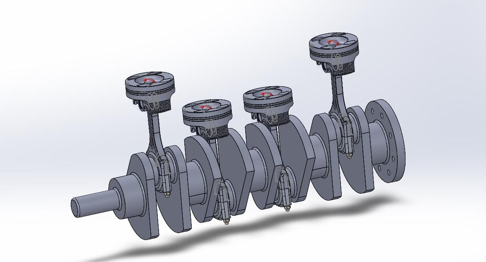
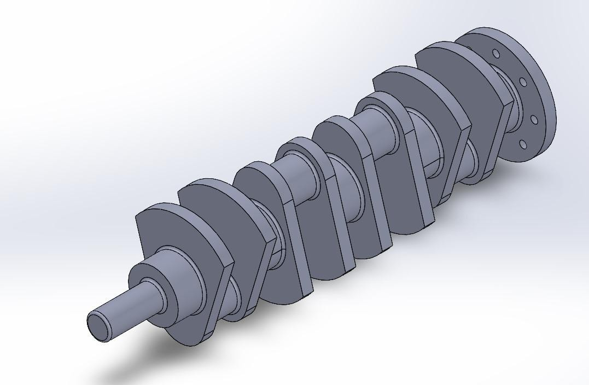
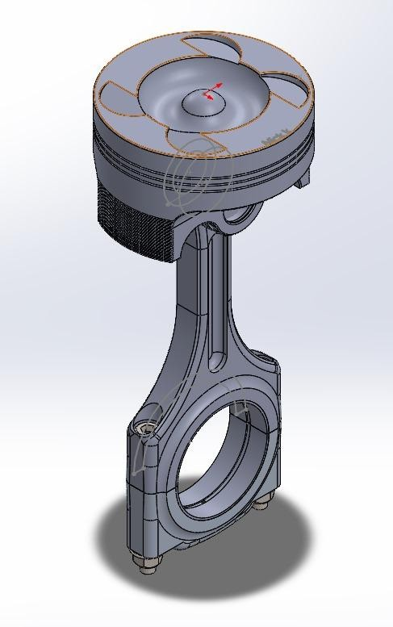
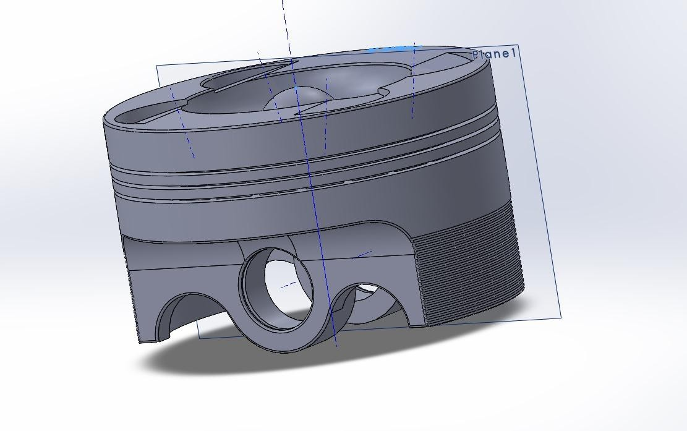
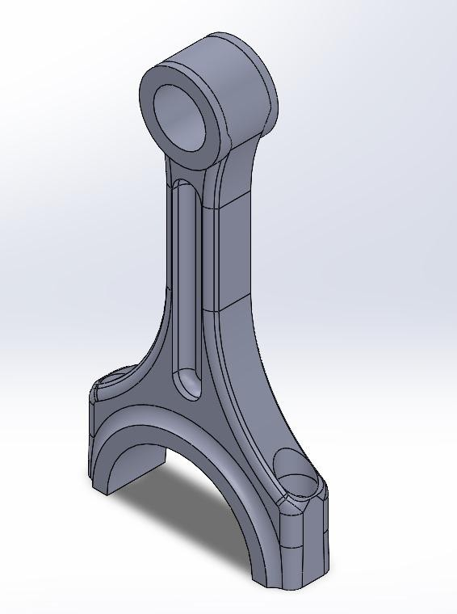
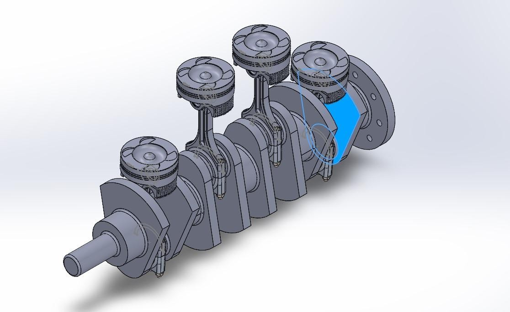

# Four-Cylinder Crankshaft Assembly in SolidWorks

A 3D model of an inline four-cylinder engine's rotating assembly: crankshaft, pistons and connecting rods, built in SolidWorks, assembled with mates, and animated with a motion study.

University CAD project, Warsaw University of Technology.



## What's in it

- **Crankshaft:** modelled as a single part, with main journals, crank throws with their webs, and a flywheel flange
- **Piston:** with ring grooves and a wrist-pin bore
- **Connecting rod:** with a bolted big-end cap, so it can clamp around the crank pin
- **Assembly:** four piston-and-rod sets mated to the crankshaft, with the fasteners and small details added, so the whole mechanism turns as one
- **Motion study:** simulates the crankshaft rotating and driving the pistons up and down over time

| Crankshaft | Piston and connecting rod |
|---|---|
|  |  |

| Piston | Connecting rod |
|---|---|
|  |  |



## Files

```
cad/crankshaft_assembly.SLDASM   Main assembly, including the motion study
cad/engine part 1–4.SLDPRT       The individual parts referenced by the assembly
```

**Open it:** keep all files in the same folder and open `crankshaft_assembly.SLDASM` in SolidWorks. Don't rename the part files, because the assembly finds them by name.

## Tools

SolidWorks (part modelling, assembly mates, motion study).
